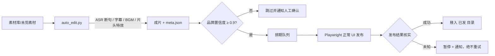

# 抖音团购视频自动化工作台

**Douyin Group-Buy Video Studio** —— 把「一堆未剪素材」变成「按时发布的团购短视频」的本地自动化流水线。

自动剪辑、AI 字幕、BGM 匹配、品牌识别、排期发布、发布结果核实与失败自愈，全部跑在本地 Windows 上。


> 关键词：抖音团购 · 本地生活 · 短视频自动化 · 批量剪辑 · AI 字幕 · Whisper ASR · 品牌 OCR · 定时发布 · Playwright · ffmpeg

---

## 这个项目解决什么问题

做本地生活团购，每天都有大量探店、试吃、门店素材需要剪成竖屏短视频，再按节奏逐条上传。人工处理既重复又容易漏发、发错、重复发。

这个项目把整条链路串成一条可无人值守的本地流水线：

```
素材进目录  →  自动剪辑  →  品牌/商品核验  →  排期发布  →  结果核实与通知
```

不需要云端服务器，不需要手动上传；关掉终端后仍由 Windows 计划任务继续运行。

## 核心能力

| 模块 | 做了什么 | 关键实现 |
| --- | --- | --- |
| 自动剪辑 | 语音断句、生成/保留字幕、匹配 BGM、片头特效、竖屏导出 | faster-whisper + ffmpeg，1080×1920 / 30fps / HEVC |
| 字幕策略 | 检测到素材自带烧录字幕时整条跳过，不遮挡、不重复叠加 | 帧采样 + 文字区域检测 |
| 品牌识别 | 画面 OCR + 口播文本 + 人工覆盖三层判断，置信度不足不猜 | Dabao-OCR 本地服务 + 品牌别名匹配 |
| 定时发布 | 按天递增排期，窗口 09:00–22:30，最小间隔 25 分钟 | Node.js + Playwright 操作正常发布界面 |
| 库存自愈 | 可用成片不足时自动拉起剪辑补货，空闲时清库存 | `run_due.js` / `prepare.js` |
| 结果核实 | 发布后到内容管理确认状态；结果未知绝不重试 | 状态机 + `clickedPublish` 标记 |
| 安全闸门 | 验证码 / 登录失效 / 品牌低置信度时全局暂停并通知 | 全局暂停开关 + 双通道通知 |
| 人工兜底 | 品牌不确定、商品不确定、发布结果未知时交人处理 | 覆盖配置 + `pending_verify` 队列 |

## 工作流



剪辑完成后，成片写入 `素材库/已剪成片`，源素材移入 `素材库/未剪素材/已剪`；发布成功后成片移入 `素材库/已剪成片/已发`。

## 技术栈

- **剪辑与识别**：Python 3.12、faster-whisper、ffmpeg、Dabao-OCR
- **发布与调度**：Node.js 24、Playwright、Windows 任务计划程序、PowerShell
- **配置与状态**：JSON 配置 + 本地状态文件，无数据库、无云端依赖

## 目录结构

```text
tuangou/
├─ scripts/
│  ├─ auto-edit/          # 自动剪辑：ASR、字幕、BGM、品牌 OCR、片头特效
│  └─ publish/            # 自动发布：排期、库存、上传、核实、通知
├─ docs/
│  ├─ adr/                # 架构决策记录
│  └─ handover/           # 发布流程与交接文档
├─ assets/                # 公开素材线索与审核清单
├─ 素材库/                # 本地素材与成片（已 git 忽略）
└─ runtime/               # 运行态、模型、浏览器会话（已 git 忽略）
```

## 快速开始

### 1. 环境准备

- Windows 10/11
- Python 3.12（含 faster-whisper 与 ffmpeg）
- Node.js 24 与 Playwright Chromium
- 本机 Dabao-OCR 服务（`http://127.0.0.1:18224`）

### 2. 配置路径

复制并修改两份配置，把所有 `D:/...` 路径改成你自己的目录：

- `scripts/auto-edit/config.json`
- `scripts/publish/config.json`

### 3. 试运行

先剪辑，再走无副作用的发布演练：

```bash
python scripts/auto-edit/auto_edit.py --all
node scripts/publish/run_due.js --dry-run
```

### 4. 首次登录与正式运行

首次发布前，用独立的浏览器 profile 登录你自己的账号：

```bash
node scripts/publish/login.js
```

确认 `--dry-run` 无异常后，再交给计划任务按排期运行。详细步骤见 [`scripts/publish/README.md`](scripts/publish/README.md)。

## 安全与合规边界

这个项目刻意选择「慢而稳」：

- 只操作**你本人已授权的账号**，只使用平台可见的正常界面。
- **不做**鼠标轨迹伪造、随机延时绕风控、验证码绕过或任何安全校验规避。
- 出现验证码、登录失效或账号异常时，**暂停全部发布任务**，交人工处理。
- 默认 `dry-run`；首次真实发布必须由人明确批准。
- 点击「发布」后若结果无法确认，**标记待核实并暂停，绝不自动重试**，避免重复发布。
- 发布时按平台要求勾选「内容由 AI 生成」声明。
- 品牌或商品无法确认时跳过，不猜着发。
- 账号 Cookie、浏览器会话、用户数据不会进入版本库（`runtime/` 已忽略）。

请自行确认并遵守抖音平台规则、广告法与所在地区法规。自动化发布存在账号风险，使用即表示你理解并自行承担。

## 文档导航

| 文档 | 内容 |
| --- | --- |
| [开发规格](douyin-groupbuy-studio-development-spec-v1.0.md) | 需求基线与验收标准 |
| [架构说明](docs/ARCHITECTURE.md) | 模块划分与设计约束 |
| [能力矩阵](docs/CAPABILITY_MATRIX.md) | 平台能力实测状态 |
| [ADR-001](docs/adr/ADR-001-multi-image-post.md) | 多图发布决策 |
| [ADR-002](docs/adr/ADR-002-ai-video-workflow.md) | AI 视频工作流决策 |
| [视频发布流程](docs/handover/DOUYIN_VIDEO_PUBLISH_WORKFLOW.md) | 自动发布固化参数与异常处理 |
| [变更记录](CHANGELOG.md) | 迭代记录 |

## 路线图

- [x] Phase 0：账号、上传界面、渲染与 OCR 能力验证
- [x] 自动剪辑：ASR 字幕、BGM、品牌识别、片头特效
- [x] 定时自动发布：排期、库存自愈、失败暂停与通知
- [ ] 图文多图发布模块（当前暂停）
- [ ] 发布数据看板与效果回收
- [ ] 更多平台适配

## 说明

这是一个面向个人/小团队的真实在用的本地工具，优先稳定与可追溯，而不是做成通用 SaaS。文档以中文为主，代码按实际运行环境组织；如果它对你的内容流水线有启发，欢迎 Star 或提 Issue。

## 许可证

暂未声明开源许可证。如需复用代码或素材流程，请先联系作者确认授权。
